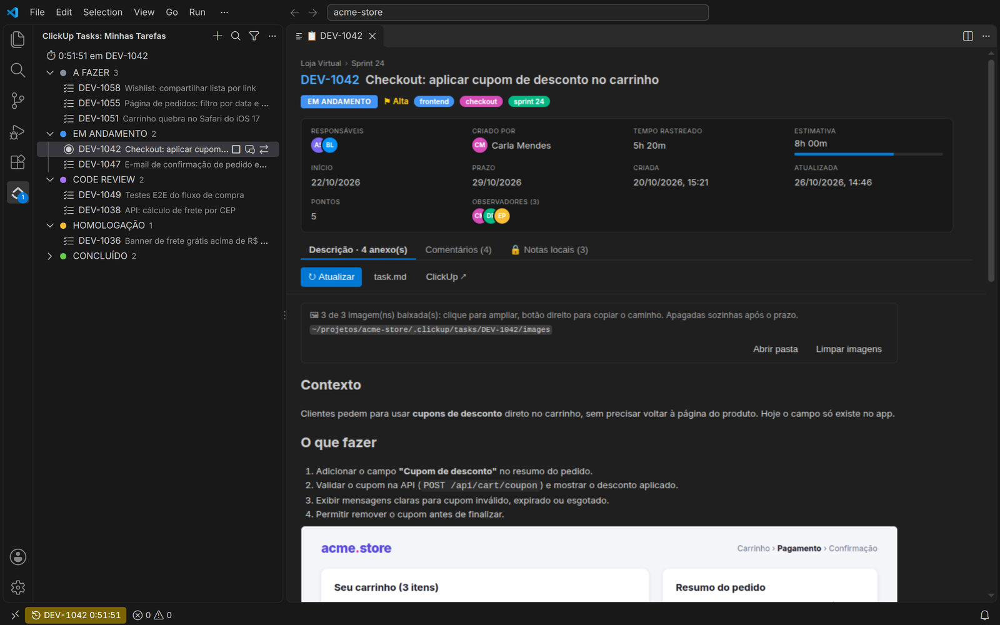
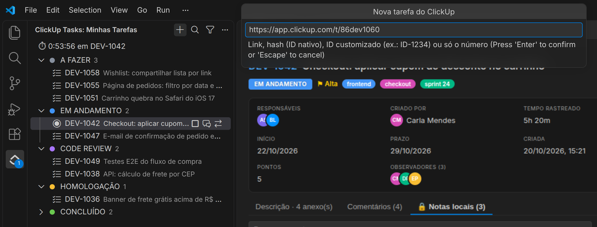
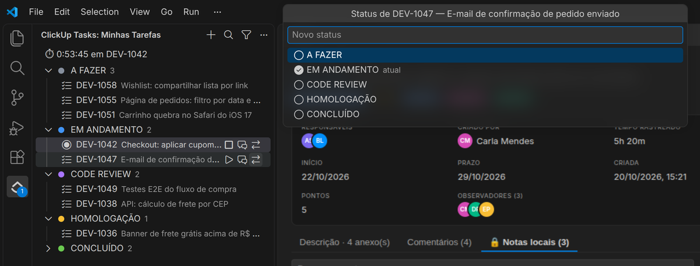
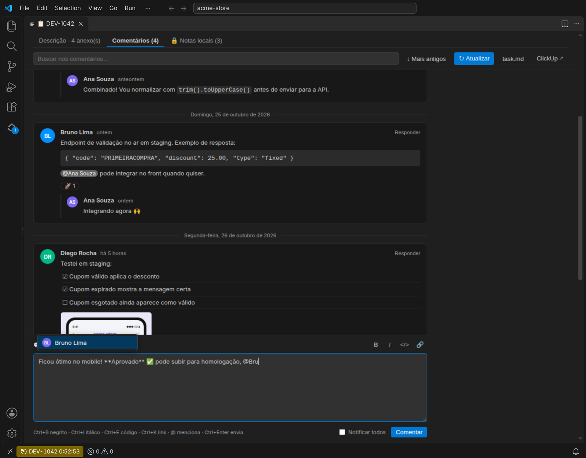
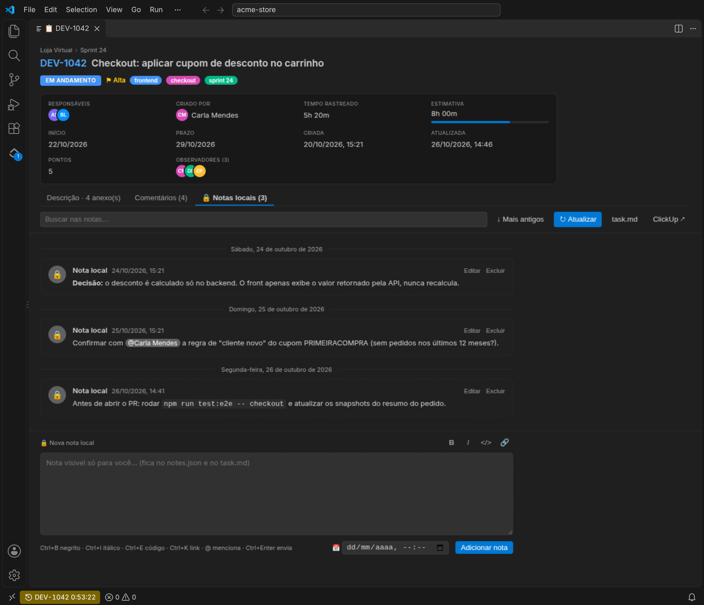
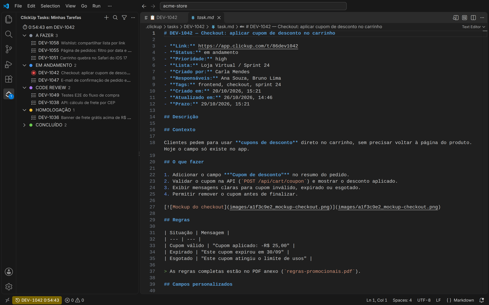

# ClickUp Tasks

**Traga suas tarefas do ClickUp para dentro do VS Code e entregue o contexto completo para a sua IA.**

A extensão importa uma tarefa do ClickUp (descrição, campos personalizados, checklists, subtarefas, comentários e anexos) para um `task.md` local. Basta referenciar esse arquivo no Copilot, Claude Code, Codex, Cursor ou qualquer outro assistente, e a IA passa a trabalhar com a tarefa inteira, sem copiar e colar.

Além disso, você acompanha, comenta, muda o status e marca o tempo das tarefas sem sair do editor.



---

## ✨ Recursos

- 📥 **Importa pelo ID, pelo número ou pelo link**: `ID-49228`, `49228`, `#17twvjwwqeu` ou `https://app.clickup.com/t/...`.
- 🤖 **Markdown pronto para IA**: um `task.md` limpo por tarefa, com tudo o que importa.
- 🗂️ **Lista lateral por status**: na ordem e nas cores do ClickUp, com pesquisa e filtro.
- 📋 **Painel da tarefa**: status, prioridade, responsáveis, prazos, tempo rastreado, checklists, subtarefas e anexos.
- 💬 **Comentários completos**: leia, responda e comente no ClickUp com formatação e `@menção`.
- 🔒 **Notas locais**: anotações que **não vão para o ClickUp**, mas que a IA enxerga.
- ⏱️ **Timer integrado**: inicie e pare o timer do ClickUp; o tempo aparece na barra de status.
- 🔄 **Alterar status** direto da lista, com os status da lista da tarefa no ClickUp.
- 🖼️ **Imagens sob demanda**: baixe as imagens quando precisar; elas se apagam sozinhas depois.

---

## 🚀 Começando

1. **Conecte sua conta.** `Ctrl+Shift+P` → **ClickUp: Token da API** e cole o seu token pessoal.
   No ClickUp: avatar → **Settings** → **Apps** → **API Token** (começa com `pk_`).
2. **Importe uma tarefa.** Clique no ícone **ClickUp Tasks** na Activity Bar e no botão **+**.
3. **Use com a IA.** Abra a tarefa e referencie o `task.md` no chat, por exemplo:

   > Implemente o que está descrito em `@.clickup/tasks/ID-49228/task.md`

Pronto. Para trazer mudanças feitas no ClickUp, use **Atualizar tarefa do ClickUp** (ícone 🔄).

---

## 📖 Como funciona

### Importar tarefas

O botão **+** (ou **ClickUp: Nova tarefa**) aceita:

| Você digita | O que acontece |
| --- | --- |
| `ID-49228`, `id 49228` | ID customizado (maiúsculas ou minúsculas, com hífen ou espaço) |
| `49228` | Tenta `ID-49228`, depois os outros prefixos configurados e, por fim, como ID nativo |
| `17twvjwwqeu` ou `#17twvjwwqeu` | ID nativo do ClickUp |
| `https://app.clickup.com/t/...` | Link da tarefa |

Ao importar, o painel da tarefa abre automaticamente.



### Lista lateral



- Agrupada por **status**, na ordem e com as cores do ClickUp; concluídas ficam por último, recolhidas.
- **🔍 Pesquisar** filtra enquanto você digita, pelo título ou pelo ID, sem diferenciar acentos.
- **Filtrar por status** mostra só os status que existem nas suas tarefas, com contagem e múltipla escolha.
- Filtros ficam salvos por workspace. O menu **…** alterna entre lista agrupada e lista simples.
- Ao passar o mouse: ▶ timer, 💬 comentários e ⇄ alterar status. O botão direito tem o resto (atualizar, abrir pasta, abrir no ClickUp, imagens e remover).

### Painel da tarefa

Clicar numa tarefa abre um painel no estilo do ClickUp, com cabeçalho (status, prioridade, tags, responsáveis, criador, tempo rastreado × estimativa, datas, pontos, observadores e lista; prazo destacado quando atrasado) e três abas:

- **Descrição**: texto, campos personalizados, checklists, subtarefas e galeria de anexos.
- **Comentários**: os comentários do ClickUp.
- **🔒 Notas locais**: suas anotações privadas.

### Comentários



- Cards por autor, agrupados por dia, com respostas em thread, imagens, busca e ordem invertível.
- **Comente e responda** direto no ClickUp, com `**negrito**`, `_itálico_`, `` `código` ``, links e `@menção` com autocompletar.
- Atalhos: `Ctrl+B`, `Ctrl+I`, `Ctrl+E` e `Ctrl+K`.

### Notas locais



Anotações que ficam só na sua máquina: rascunhos, decisões técnicas, lembretes. Elas têm data, podem ser editadas e excluídas, e aparecem numa seção **Notas locais** do `task.md`, para a IA também levar em conta. Sobrevivem à atualização da tarefa.

### Timer

- **▶ Iniciar timer** em qualquer tarefa; a que está contando fica marcada com ● e ⏱.
- O tempo corre na **barra de status** (clique para parar).
- O ClickUp permite um timer por pessoa: iniciar numa tarefa para o que estiver rodando, inclusive um timer iniciado no ClickUp web.
- Sincroniza com o ClickUp a cada minuto e quando a janela ganha foco.

### Imagens e anexos

Por padrão nada é baixado: imagens, vídeos e arquivos ficam como link do ClickUp.

- **Botão direito → Baixar imagens** baixa só as imagens da tarefa (vídeos e outros arquivos nunca são baixados). A descrição passa a usar os arquivos locais, e clicar numa imagem a amplia no VS Code, com zoom.
- **Botão direito numa imagem**: copiar caminho, abrir em aba, copiar link ou abrir no navegador.
- **Limpar imagens** apaga na hora; e a **limpeza automática** apaga cada imagem 3 horas depois do download (configurável).

---

## 📁 Estrutura gerada

```
.clickup/tasks/
├── .gitignore        # "*": as tarefas não entram no git do seu projeto
└── ID-49228/
    ├── task.md       # a tarefa legível, para você e para a IA
    ├── task.json     # resposta bruta da API
    ├── comments.json
    ├── notes.json    # notas locais (se houver)
    └── images/       # só se você usar "Baixar imagens"
```



---

## ⚙️ Configurações

| Configuração | Padrão | Descrição |
| --- | --- | --- |
| `clickupTasks.tasksFolder` | `.clickup/tasks` | Onde salvar as tarefas: relativo ao workspace, absoluto ou `~/...`. Com um caminho fixo, todas as janelas compartilham as mesmas tarefas. |
| `clickupTasks.teamId` | _(automático)_ | ID do workspace do ClickUp, usado para IDs customizados. |
| `clickupTasks.numericIdPrefixes` | `["ID"]` | Prefixos tentados quando você digita só o número. Ex.: `["ID", "DEV"]`. |
| `clickupTasks.groupByStatus` | `true` | Agrupar a lista por status. |
| `clickupTasks.imageRetentionHours` | `3` | Horas até as imagens baixadas serem apagadas. |

---

## 🔐 Privacidade

- O token fica no **keychain do sistema** (Secret Storage do VS Code), nunca em arquivo.
- A extensão só se comunica com a **API oficial do ClickUp** (`api.clickup.com`). Nenhum dado é enviado a terceiros.
- As tarefas ficam em arquivos locais, e a pasta já vem com `.gitignore` para não ir parar no seu repositório por engano.
- As notas locais nunca saem da sua máquina.

---

## 🛠️ Desenvolvimento

```bash
npm install
npm run watch      # rebuild contínuo
npm run compile    # type-check + build em dist/
npm run package    # gera o .vsix
```

Para depurar, abra a pasta no VS Code e aperte **F5**.

Encontrou um problema ou tem uma ideia? Abra uma [issue](https://github.com/renanvnunes/clickup-vscode/issues).

---

<sub>Licença [MIT](LICENSE). Extensão não oficial, sem vínculo com a ClickUp. ClickUp é marca registrada de seus respectivos donos.</sub>
